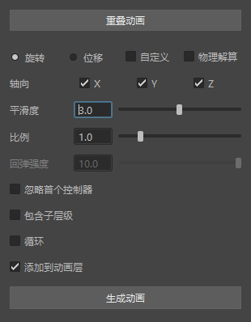

# Overlap Helper · 重叠动画助手

用于 **Maya 2025–2027** 的重叠动画插件。根据控制器或关节链已有的动画，生成旋转或位移的延迟跟随，并烘焙为可编辑的关键帧。适合为尾巴、触手、头发链、饰带等添加次级运动，减少逐个控制器手动错帧的工作。

当前源码版本：**1.3.1**。界面为中文，支持动画层输出、一键撤销和拖拽安装。



## 插件功能

- **旋转与位移重叠**：读取 Maya 当前播放范围，将已有运动转为延迟跟随动画；可按 X、Y、Z 筛选输出通道。
- **两种计算方式**：默认使用关键帧时间偏移；开启“物理解算”后使用 nParticle 目标跟随，生成带回弹的运动。
- **自定义方向**：为单个控制器创建局部方向的虚拟末端，按选定轴向生成旋转重叠。
- **控制器链与层级处理**：支持手动按顺序选择控制器，也可选择根控制器并展开子层级。曲线控制器链会跳过无曲线的偏移组，多个根分别生成结果层。
- **保留首个控制器**：普通旋转模式可忽略每条链的首个控制器，让根部保留原动画。
- **循环烘焙**：额外计算一个周期，再将结果移回当前播放范围，适用于已设置好周期首尾姿态的动画。
- **动画层或直接写入**：默认建立 `OverlapHelper` 动画层，方便静音比较和调整权重；也可将结果直接写回原动画曲线。
- **计算与场景恢复**：运行时暂停视口画面更新，完成或异常后恢复原暂停状态。生成操作合并为一次撤销，失败或中断时回滚本次修改，并清理工具创建的临时节点。

## 下载与安装

正式安装包仅通过 [GitHub Releases](https://github.com/luanzhuoyuanyue/Overlap-Helper/releases) 分发，选择已发布版本中的 ZIP 附件。

1. 解压完整 ZIP，保留 `install.py` 旁的 `overlap_motion` 文件夹。
2. 打开对应版本的 Maya，将 `install.py` 拖入三维视图。
3. 中文窗口自动打开，工具架出现 **OH** 按钮；之后点击 OH 即可打开插件。

重复安装会自动备份旧包、更新同一个 OH 按钮并重新加载代码。使用多个 Maya 版本时，需要分别安装一次。源码版本与安装包的发布记录分别见仓库和 Releases。

## 快速使用

1. 按根部到末端顺序选择控制器链；使用“包含子层级”时，选择根控制器。
2. 设置 Maya 播放范围，并选择“旋转”或“位移”。
3. 从默认参数开始，按需要调整平滑度、比例和物理解算选项，然后点击“生成动画”。
4. 在动画层编辑器中静音结果层比较效果，或调整层权重。按 **Ctrl+Z** 撤销整次生成。

普通旋转模式至少需要两个控制器；单个控制器可使用旋转的“自定义”模式，或直接使用位移模式。重新生成前应静音旧结果层，否则当前可见动画会成为新一轮输入。

## 参数说明

| 参数 | 作用 |
|---|---|
| 旋转 / 位移 | 选择输出旋转或位移；默认旋转。 |
| 自定义 | 用局部轴向的虚拟末端生成旋转，开启后默认 Y 轴。多轴勾选时按 X、Y、Z 顺序取最后一个勾选轴，输出三个旋转通道。 |
| 轴向 | 普通模式筛选要生成的通道；自定义模式选择局部偏移方向。 |
| 物理解算 | 开启 nParticle 目标跟随；关闭时使用关键帧时间偏移。 |
| 平滑度 | 默认方式下为延迟帧数，默认 3、最小 0.1；物理解算下控制解算时间比例，默认 8、范围 2–9。切换计算方式会重置此值。 |
| 比例 | 默认 1、最小 0.1；目标偏移距离按其倒数缩放，非物理解算的旋转延迟同时乘以此值。位移模式下不可编辑。 |
| 回弹强度 | 对应粒子的目标跟随平滑参数，默认 10、最小 1；仅物理解算启用。 |
| 忽略首个控制器 | 保留每条链首个控制器的原动画；用于普通旋转模式。 |
| 包含子层级 | 展开所选根控制器下面的控制器链。 |
| 循环 | 多计算一个周期后移回当前范围；播放结束帧应为下一周期首帧的重复姿态，需要动画层输出。 |
| 添加到动画层 | 默认开启；关闭后直接替换播放范围内所选通道的关键帧。 |

锁定的输出轴会跳过。已有动画层的通道应保持“添加到动画层”开启。动画层权重默认恒定，如只需要局部效果，可另外为层权重设置关键帧。

## 兼容性与验证

| Maya 版本 | 验证状态 |
|---|---|
| 2025.3 | 本机验证通过：55 项自动检查、27 项 GUI 检查。 |
| 2027.1 | 本机验证通过：55 项自动检查、27 项 GUI 检查。 |
| 2026 | 兼容目标，本机未安装，未实机验证。 |

运算与参数行为以本机 Maya 2023.3 原版的实际结果为依据。2025、2027 均通过 **23 组逐帧轨迹对照**，覆盖旋转/位移、物理解算、自定义轴向、比例、分数延迟、循环、忽略首项、直接写入、锁定轴和多条层级链；所测通道误差低于 0.0001 cm / 度。

当前版本减少重复求值、临时约束和层级操作，并加强异常恢复与撤销保护。此前 v1.3.0 的 24 个控制器、121 帧测量中，非物理解算速度为 v1.2.0 的约 **2.1–2.9 倍**；物理解算未显示稳定提速，旋转模式中位数略慢。该计时不包含本次视口暂停的 GUI 开销变化，数据和方法见 [验收报告](验收报告.md)。

以整数帧烘焙，生成前须开启 Maya 撤销并关闭动画层独显。约束、表达式等直接驱动的输出通道会提前提示。复杂绑定、不同帧率、非均匀或负缩放等仍需在具体场景中验证。

## 开发方式与文档

**本项目由纯 AI（OpenAI Codex）编写与适配。** 用户提出需求，代码实现、界面适配、文档整理和测试执行均由 AI 完成。仓库保留完整 Python 源码与本机验证记录。

- [使用说明](使用说明.md)：详细参数、安装更新及使用注意事项。
- [验收报告](验收报告.md)：逐帧对照、失败恢复、性能测量与验证限制。
- [还原依据](docs/overlap-reference.md)：原版行为和数值基准来源。
- [更新说明](release-notes.md)：当前版本的改动。
- `qa/`：测试日志、误差记录、性能数据与实际界面截图。
- `tests/fixtures/`：Maya 2023.3 原版记录的数值基准。

安装后也可在 Maya 的 Python 脚本编辑器运行：

```python
import overlap_motion
overlap_motion.show()
```

开发验证：在源码目录运行对应版本的 `mayapy.exe -B tests/run_maya.py`。`tests/gui_smoke.py` 会建立测试场景并退出 Maya，仅用于独立测试配置。性能对比工具与运行方法见验收报告。
